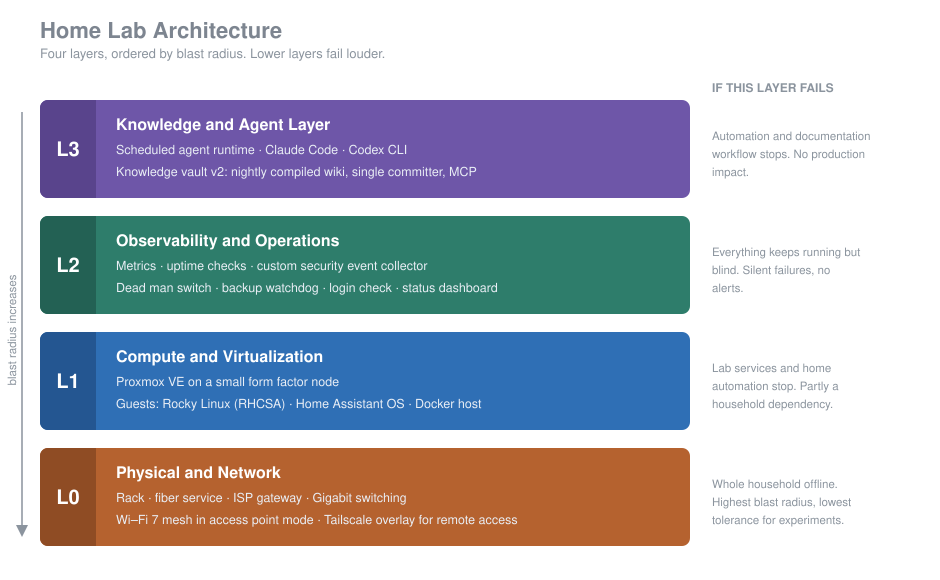
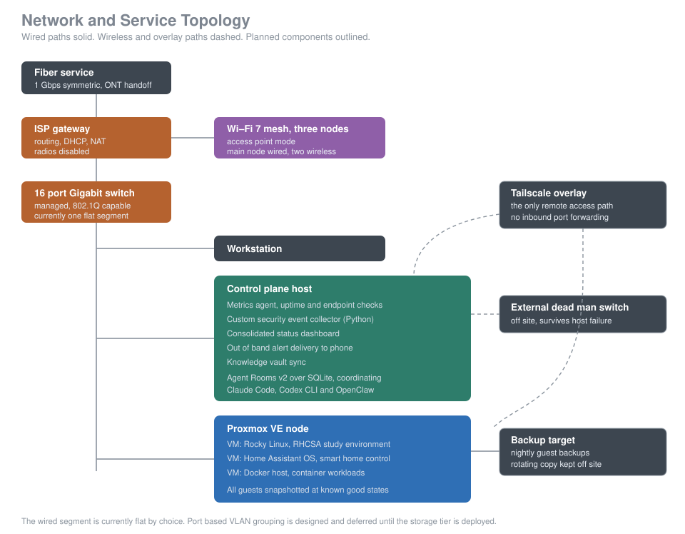

# Home Lab: Architecture, Operations, and Lessons

A working home lab built as a study platform for Linux and cloud certification, a smart home control plane, and a place to practice the operational habits that production environments actually require: monitoring, alerting, backup discipline, and change control. The operational practices here carry over from professionally managing a mixed OS fleet of over 1,000 endpoints, which is where most of them were learned under real consequences.

This document is the public edition. It covers architecture, design reasoning, and the mistakes worth writing down. Operational specifics such as addressing, device inventory, and physical security details are deliberately excluded. See [What this document does not cover](#what-this-document-does-not-cover).

---

## Contents

- [Architecture at a glance](#architecture-at-a-glance)
- [Layer 0: Physical and network](#layer-0-physical-and-network)
- [Layer 1: Compute and virtualization](#layer-1-compute-and-virtualization)
- [Layer 2: Observability and operations](#layer-2-observability-and-operations)
- [Layer 3: Knowledge and agent orchestration](#layer-3-knowledge-and-agent-orchestration)
- [Design principles](#design-principles)
- [Lessons learned](#lessons-learned)
- [Incidents](#incidents)
- [Troubleshooting playbook](#troubleshooting-playbook)
- [Performance notes](#performance-notes)
- [Roadmap](#roadmap)
- [What this demonstrates](#what-this-demonstrates)
- [What this document does not cover](#what-this-document-does-not-cover)
- [License](#license)

---

## Architecture at a glance

The lab is designed as four layers rather than a pile of hardware. Each has a different failure mode, a different tolerance for experimentation, and a different upgrade trigger. Ordering them by blast radius is the single most useful framing I have applied to it, because it decides what may be changed on a weeknight and what may not.

The rule that falls out of this: **anything the household depends on is production.** Internet access and home automation are not lab equipment. They get change windows, rollback plans, and weekend mornings rather than midnight experiments.

---

## Layer 0: Physical and network

A self built rack carrying the compute node, the control plane host, and the wired distribution layer. Internet is 1 Gbps symmetric fiber. Wireless is a Wi‑Fi 7 mesh running in access point mode behind the gateway, so routing, DHCP, and NAT stay in one place instead of being split across two devices.

Remote access is a Tailscale overlay and nothing else. There is no inbound port forwarding anywhere in the environment. This is a deliberate constraint rather than a limitation: it removes an entire category of exposure and it costs nothing in usability.

**One exception, stated plainly.** The knowledge vault's MCP server is reachable from the public internet through the overlay's funnel feature, because hosted chat apps cannot join a private tailnet. It is a single endpoint, it sits behind OAuth with an unguessable path, and it refuses every request without a token. Everything else, including every dashboard and the hypervisor, is reachable only from inside the overlay.

**The honest state of this layer:** the wired network currently runs as a single flat segment, and that is a configuration choice rather than a hardware limitation. The switch is a managed unit supporting 802.1Q and port based VLANs along with loop prevention, so the capability is present and simply unused today. A port based VLAN design is already worked out: trusted compute and storage grouped into one segment, separated from a general purpose lane, with both sharing the uplink so internet access is preserved for every device.

Configuration is deliberately deferred until the storage device that justifies the boundary is actually deployed. Segmenting an environment before the thing being segmented exists adds risk without adding protection, because it introduces a new failure mode while protecting nothing that is present yet.

One caveat matters more than the switch configuration itself: overlay VPN tunnels bypass layer 2 isolation entirely. Segmentation at the switch does not by itself isolate devices that share a tailnet, since the overlay builds its own reachability on top of whatever the physical network does. Enforcing that boundary requires a separate access control rule at the overlay, not a VLAN.

---

## Layer 1: Compute and virtualization

Proxmox VE on a small form factor node, running three guests with distinct jobs:

| Guest | Purpose | Notes |
|---|---|---|
| Rocky Linux | RHCSA study environment | Snapshotted at a clean baseline so destructive exercises revert in seconds |
| Home Assistant OS | Smart home control plane | Treated as a household service, not a lab toy |
| Docker host | Container workloads | The landing spot for DNS filtering, secrets management, and log collection |

Snapshot discipline is applied to all guests at known good states. The Rocky guest in particular is built to be broken: the entire point of an RHCSA environment is that you can destroy the bootloader, corrupt a filesystem, or lock yourself out of SELinux and roll back in under a minute.

Alongside the hypervisor node, a small form factor Mac acts as the control plane host. It runs the monitoring stack, the agent runtime, the knowledge vault, and the dashboards. In November 2026 it moved from 16 GB to 32 GB of memory. The old host was swapping constantly; the new one runs the same workload with zero swap. The move used the operating system's own migration tool restoring from a Time Machine backup, and the old host was kept untouched for a week as a rollback path. What that migration did not carry over is written up in [Incidents](#incidents).

**Structural honesty about this layer:** it is one node with one disk carrying three workloads. That is a normal and appropriate lab design, but it concentrates risk, and pretending otherwise would be the kind of self deception that makes labs useless as preparation. Multi node clustering is a deliberate future step, ahead of faster networking, because two modest nodes teach quorum, live migration, and failover while one fast node teaches nothing new.

---

## Layer 2: Observability and operations

This is the layer that turns a collection of services into something operable, and the part I would point to first.

- **Metrics collection** for per second resolution on host and service health
- **Uptime and endpoint monitoring** for availability of internal services
- **A custom Python security event collector**, written rather than installed, so the collection logic is explainable rather than a black box
- **An external dead man switch**, hosted off site
- **Out of band alert delivery** to a phone, independent of the local network
- **A consolidated status dashboard** so health is one view rather than four browser tabs. It reads host hardware live instead of carrying a hardcoded inventory, because the hardcoded values went stale the day the hardware changed.
- **A backup watchdog** that checks the result of every nightly backup run
- **A daily login self check** before the morning scheduled jobs run. It is silent when every credential works and sends the exact repair step when one has expired.
- **A weekly host health report** covering backups, free disk, crashed services, memory pressure, and any log directory larger than 2 GB

### The design decision that matters most here

**Monitoring that runs on the thing it monitors cannot report its own death.** If the control plane host fails, every check on it fails silently, and silence is indistinguishable from health. The external dead man switch resolves that: the host checks in on a schedule from inside, and the absence of that check in triggers an alert from outside. It is the only monitor in the environment that survives the monitoring host failing.

The same reasoning applies to alert delivery, with one honest limit. The dead man switch alerts from outside, so it does not depend on the host or the local network. The scheduled reports and login checks are sent by the host itself, so they share fate with it. That is acceptable only because the dead man switch covers the case where the host is gone.

### Known gaps at this layer

Metrics answer *how much*. Logs answer *why*. Centralised log aggregation is the clearest remaining gap, alongside SMART attribute alerting on disks, since drives usually warn before they fail. Long term metric retention is also unconfigured, which means slow degradation over months is currently invisible.

Log rotation and size caps are also missing. That gap stopped being theoretical when one log file grew to 26 GB; see [Incidents](#incidents). The weekly report flags large log directories, but a weekly flag is detection, not prevention.

---

## Layer 3: Knowledge and agent orchestration

This layer runs AI agents on the control plane host and gives them one shared memory.

One agent runtime owns all scheduled and unattended work: morning briefings, an inbox watch, the daily login self check, and the weekly host health report. It delivers to a phone over iMessage. Two coding agents (Claude Code and Codex CLI) remain for interactive engineering work. A third agent runtime used earlier in the lab has been retired and stopped, which removed one set of credentials, one scheduler, and one notification channel from the environment.

The knowledge vault was rebuilt in October 2026. Raw notes and agent session summaries land in an inbox, and a smaller, cheaper model compiles them nightly into linked wiki pages. A single committer process owns git for the vault, so no agent writes history directly. An MCP server exposes the vault to chat apps, behind OAuth, through the one funnel endpoint described in [Layer 0](#layer-0-physical-and-network).

Infrastructure access for agents is designed around three constraints, and they are not negotiable for convenience:

1. **Read only by default.** Query access is the normal mode.
2. **Reachable only over the private overlay**, with the single OAuth gated vault endpoint as the documented exception.
3. **Propose and approve on every infrastructure write.** An agent proposes a change to the hypervisor, the network, or home automation, and a human approves it. Unattended jobs are allowed to read, report, and write to the knowledge vault. They are not allowed to change infrastructure state.

These constraints exist because the threat model is concrete rather than theoretical. Agent frameworks in this category have shipped critical remote code execution vulnerabilities, and community skill registries have been poisoned at scale with malicious packages, which means installing a skill is installing code that runs with the agent's permissions. The controls above are therefore layered rather than resting on a single boundary, because any one of them can be the one that fails and none is strong enough to be the only thing standing. Evaluation of new agent tooling happens in a disposable virtual machine first, and nothing moves to a permanent host until it has been watched there.

The reasoning: an agent with write access to a hypervisor or a home automation controller is an agent that can take down the household network. The approval gate costs a few seconds and removes the entire class of outcome where an automated action does something irreversible at three in the morning.

---

## Design principles

These are the rules the lab is actually built on, stated plainly because they are more portable than any hardware list.

**Snapshots are not backups.** A snapshot protects against a bad change. It does not protect against a failed disk, a stolen machine, or ransomware, because it shares fate with the volume it lives on. Treating snapshots as backup coverage is the most common self inflicted data loss in home labs, and it is convincing precisely because rollback works so well for the problems it does solve.

**Three copies, two media types, one off site.** Nothing is considered protected until that is true. In practice the highest value data in a lab is rarely the virtual machines. It is the accumulated notes, configuration, and documentation, which is also the thing most likely to exist in exactly one place.

**Current honest status: this rule is not met.** Time Machine and restic both run, but they write to partitions on the same physical external drive, and the off site copy job is dead. That is two copies on one medium with nothing off site. Separate partitions are not separate media: one drive failure takes both. Fixing this is first on the [roadmap](#roadmap).

**An untested backup is a rumour.** Backup jobs that have never been restored from are a belief, not a capability. Restore testing is scheduled work.

**A silent backup is worse than no backup**, because it produces confidence without protection. Backup jobs are wired into the same alerting as everything else, so a job that quietly stops running surfaces within a day rather than at the moment it is needed.

**Household services are production.** If people who did not build the lab depend on it, it gets change control.

**Separate the trusted path from the convenient one.** No inbound exposure, no port forwarding, one overlay for remote access.

**Name the weakness in writing.** Every environment has unfinished work. Documenting it is what makes it a roadmap instead of a surprise.

---

## Lessons learned

**A separate SSID is not a separate network.** Isolation is enforced at layer 2 by VLAN tagging, not by naming a wireless network something different. The part that is easy to miss is where the capability has to live. Consumer mesh access points running in access point mode cannot map an SSID to a VLAN even when the switch behind them is fully capable of tagging it, so the tagging has nowhere to originate. Wireless segmentation needs capable access points, not just a capable switch, and treating the switch as sufficient is how you end up with separate network names and a shared broadcast domain.

**One flat network means one compromise radius.** A camera, an appliance, or an untrusted device on the same broadcast domain as a hypervisor management interface is a design decision, whether or not it was made deliberately.

**Fiber does not need a modem.** The optical terminal is already a separate device, which means the ISP supplied router is replaceable in a way that cable equipment usually is not. Knowing which handoff is in use decides whether a future upgrade is a purchase or a purchase plus a support call.

**Real world behaviour beats benchmark numbers.** Being able to game and download large titles simultaneously without visible lag is a stronger signal of network health than whether a speed test reports 550 or 800 Mbps. Speed tests vary by server and by load, and chasing the number is a distraction.

**The bottleneck is frequently not the thing being blamed.** During large game installs, throughput approached the gigabit ceiling while the system NVMe sat at 100 percent active time. The network was fine. Storage was the constraint. Measuring before diagnosing saved a pointless network investigation.

**Bus powered external drives fail at the cable, not the platter.** Micro USB connectors on portable drives are the most common cause of a backup job dying mid write. Suspect the cable before the disk.

**Consumer external drives use hardware encryption in the USB bridge.** If that bridge dies, moving the bare drive to a SATA port does not recover the data. This is a hard argument against ever letting one be the only copy of anything.

**Secrets belong in a vault, not a config file.** I learned this the expensive way on an earlier project, through a real credential exposure that required rotating everything and rewriting repository history. Secrets now live in the operating system keychain rather than in files. That is better than a config file, but it is not a vault, and the migration incident below showed that one keychain can be a single point of failure for monitoring and backup at the same time. A proper secrets vault is still on the roadmap.

**A migration tool moves files, not trust.** Restoring a host from backup brought back every file and none of the operational identity: keychain access, privacy permissions, the overlay address, overlay publishing rules, and remote access settings all had to be rebuilt by hand. Each one surfaced as a separate failure over the following week.

**Bind services to names, not addresses.** Services bound to the old overlay address crashed on start the moment the host got a new one.

**Shared runtimes are shared dependencies.** Installing a second runtime version for one application updated a native library that a different service was still linked against, and that service stopped loading. Separately, a long running service kept running on a binary that had been replaced on disk, and the firewall stopped accepting connections to it until it was restarted. Pin runtimes per application where practical, and restart and verify listeners after any dependency upgrade.

**Every unbounded log is a storage failure waiting for a trigger.**

**Sanitize before the first commit, not after.** Publishing an environment writeup and cleaning it in a later commit leaves the original permanently recoverable in git history. The redaction has to happen before the repository exists.

---

## Incidents

These are drawn from actual failures in this environment rather than from hypotheticals, which is why the uninteresting details are left in.

### Monitoring that was silently dead

**Symptom.** An external dead man switch is configured so the monitoring host checks in on a schedule and an outside service raises an alert if the check in stops arriving. The alert fired. Working backwards from it, the check in had been failing for roughly twenty hours and nobody had noticed.

**Initial read.** I assumed the monitoring host had gone down or lost its network path, since that is the exact failure the dead man switch exists to catch. I went looking for a dead host.

**Root cause.** The host was fine and had been fine the whole time. A placeholder value had been left in the credential store instead of the real check in identifier, so the heartbeat was being posted to nothing. From the host's side everything looked correct: the scheduled job ran on time, it reported success, and it had been reporting success into the void for most of a day.

**Fix.** I corrected the stored value, then verified the whole path end to end by deliberately stopping the heartbeat and confirming that an alert actually arrived.

**What changed afterward.** No monitoring component is considered working until its alert path has been tested by deliberately triggering it. Configuration that references an external identifier is verified against the live service rather than assumed correct once it has been written down.

The broader lesson is that monitoring can fail in a way that looks identical to everything being healthy, which is why at least one check has to live outside the system it watches.

### A migration that moved everything except the secrets

**Symptom.** Right after the control plane host moved to new hardware, the external dead man switch reported it down, and the backup watchdog reported that the nightly backup had failed. The host was up and every file was present.

**Initial read.** The migration had reported success and the files were all there, so I expected services to resume on their own and treated the first alert as a network hiccup on the new machine.

**Root cause.** The migration restored the login keychain under a renamed file locked with the old host's password, so every service secret was effectively missing. The heartbeat script could not read its check in URL and exited quietly. The backup job could not read its repository password and failed the same way. The same migration also dropped privacy permissions, remote login and screen sharing, and the overlay publishing configuration, and the node came back with a new overlay address, so services bound to the old address crashed on start.

**Fix.** Recreated the missing secrets in the active keychain, granted permissions again, rebound services to the new address, restored remote access and overlay publishing, then verified the heartbeat reached the external service and a backup ran to completion.

**What changed afterward.** The old host stayed untouched as rollback until the new one passed every check. A daily login self check now runs before the scheduled jobs. The alert path worked exactly as designed: the dead man switch fired, the watchdog caught the backup failure, and Time Machine kept running, so one copy existed throughout. The uncomfortable part is that this is the second time a heartbeat went quiet because of a credential store problem, which is why a secrets vault and loud failure on missing secrets are now on the roadmap.

### A log file that ate half the disk

**Symptom.** Free space on the control plane host dropped by roughly half with no new workload.

**Initial read.** The metrics agent looked healthy, so I did not suspect it first and started with the usual suspects: caches and downloads.

**Root cause.** A collector plugin in the metrics agent hit a permission error and logged it about a thousand times a second. The log had no rotation and no size cap, and it reached 26 GB. The permission error itself traced back to privacy permissions that did not survive the migration.

**Fix.** Truncated the file and turned that log output off.

**What changed afterward.** The weekly health report flags any log directory over 2 GB. Rotation and hard size caps are still missing, which is why they are on the roadmap.

### Broadcast storm from a cabling loop

**Symptom.** While cabling the switch for the first time, a machine came up with a self assigned link local address instead of a lease. It was physically connected and nothing was answering its DHCP request.

**Initial read.** A self assigned address usually points at DHCP, so I started on the gateway and its lease configuration. That was the wrong end of the problem, and it cost time.

**Root cause.** Two separate physical faults. The first was an uplink cable that was not fully seated, which accounted for the missing lease. The second, found while tracing the first, was a redundant cable run that had created a physical loop between two switch ports. Switches flood broadcast traffic out every port when the destination is unknown, and in a loop that frame comes back and is flooded again, circulating and multiplying until it saturates the segment.

**Fix.** I seated the uplink properly, removed the redundant run, and enabled loop prevention on the switch. Spanning Tree Protocol prevents this class of failure by detecting redundant paths and blocking one of them, leaving a loop free topology, then unblocking the backup path if the active one fails.

Worth naming the connection explicitly: STP runs a spanning tree algorithm over the switch topology graph. It is the same algorithm taught in a data structures course, applied to physical hardware instead of an abstract graph, and seeing it show up as a real outage is a better argument for the theory than any assignment was.

**What changed afterward.** Loop prevention is enabled on the switch. Cables are labeled at both ends. One cable gets seated fully before the next one is handled, rather than fanning several in at once and sorting it out afterwards.

Verify physical topology before suspecting configuration, because the cheapest explanation is usually a cable.

---

## Troubleshooting playbook

Condensed from actual incidents rather than written from theory.

<b>Wired throughput drops on a single machine</b>

1. Confirm the negotiated link speed at the operating system level before testing anything else. A port that negotiated at 100 Mbps looks exactly like a slow internet connection.
2. Pause background updaters and game launchers, then test three times against the same server. One test against one server is noise.
3. Move the machine to a different switch port. Port position should not matter, but a faulty port, cable, or duplex setting is common and cheap to rule out.
4. Test directly into the gateway. If direct is fast and switched is slow, the problem is the switch, its uplink, or the cable to it.
5. Remember that connected devices do not divide bandwidth equally. Only active traffic consumes it.

<b>Wireless is inconsistent in part of the coverage area</b>

1. Confirm which mesh node the client is actually associated with. Clients hold onto a distant node longer than expected.
2. Place satellites where they still hold a strong link back to the wired node, not at the far edge of the dead zone. A satellite with a weak backhaul extends the problem rather than solving it.
3. Avoid running two wireless systems in parallel. Once the mesh is verified, disable the gateway radios so they are not competing.

<b>A machine feels sluggish during large downloads</b>

1. Check disk active time before blaming the network or memory. Sustained 100 percent disk utilisation is the usual culprit during install and decompression.
2. Memory at 70 to 75 percent is not automatically a problem. Look for paging, not for a high percentage.

<b>A virtual machine will not start</b>

1. Check host storage capacity first. Accumulated snapshots silently consuming the volume is the most common cause in a single node environment.
2. Roll back to the last known good snapshot rather than debugging live, then investigate the failed state from a position of safety.
3. If the host filesystem is suspect after an unclean shutdown, stop writing to it and restore rather than repairing in place.

<b>Alerts have gone quiet</b>

1. Silence is ambiguous. It means either nothing is wrong, or the monitoring host is dead.
2. The external dead man switch is what disambiguates. If it has not fired, the host is alive and the silence is real.
3. Test the alert delivery path on a schedule. An alerting path that has never fired in anger is an assumption.
4. The inverse case matters too: the switch firing does not prove the host is dead. Twice now the host was healthy and the check in itself was broken. Check the heartbeat job and its stored credential before chasing the host.

<b>After moving a host to new hardware</b>

1. Confirm the keychain the services read is the active one, and that each service secret is present.
2. Re grant privacy permissions: screen recording, accessibility, files and folders, full disk access.
3. Check the overlay address. Anything bound to the old one will crash on start.
4. Restore overlay publishing rules and turn remote login and screen sharing back on.
5. Re authenticate every scheduled tool and confirm each job's next run succeeds, not just that it is scheduled.
6. Confirm the external heartbeat arrives and a backup completes end to end before retiring the old host.

---

## Performance notes

| Observation | Finding |
|---|---|
| Baseline wired throughput | Roughly 850 to 900 Mbps on a clean test |
| Gateway latency | Sub millisecond, zero loss, indicating a healthy local path |
| Repeated speed tests | Varied widely by server and by concurrent load, from roughly 500 to 800 Mbps |
| Large game download | About 655 Mbps sustained to disk, with the interface later observed near 953 Mbps |
| Bottleneck during install | System NVMe at 100 percent active time while CPU sat near 18 percent |
| Resolution of an intermittent slowdown | Relocating the machine to a different switch port restored expected throughput |
| Control plane memory upgrade | 16 GB host swapping constantly at about 14 GB in use; 32 GB host at the same workload with zero swap |

The practical conclusion: the environment can saturate its uplink, and variance between individual tests is not evidence of a fault.

---

## Roadmap

Ordered by value delivered rather than by how interesting the project is. The unglamorous items are first on purpose.

| Priority | Item | Why it ranks here |
|---|---|---|
| 1 | Second physical backup medium | Two copies on one drive is one failure away from zero |
| 2 | Off site copy revived, with alerting | The existing off site job is dead, not merely absent |
| 3 | Tested restore from both backup tools, plus the migration checklist as a runbook | The hardware move was a partial restore test, and it showed what does not come back |
| 4 | Loud failure on missing secrets, log rotation and size caps | Three incidents shared the same quiet exit pattern |
| 5 | Secrets vault | One keychain was a single point of failure for monitoring and backup at once |
| 6 | Power protection with graceful shutdown integration | Unclean shutdown is the most common cause of hypervisor filesystem damage |
| 7 | Centralised logging and DNS filtering | Fills the remaining service and operational gaps |
| 8 | VLAN segmentation configuration | The switch already supports it. The prerequisite is the storage tier that justifies the boundary, not a hardware purchase. |
| 9 | Multi node cluster, then multigig internal networking | Quorum and failover are the next learning step; multigig only once local transfers saturate Gigabit |

Deliberately **not** on the roadmap: faster internet service. The internal network is the constraint, not the circuit, and buying bandwidth to solve a switching problem is how labs get expensive without getting better.

---

## What this demonstrates

| Capability | Evidence |
|---|---|
| Linux administration | Rocky Linux RHCSA guest, rebuilt from snapshot, in [Layer 1](#layer-1-compute-and-virtualization) |
| Type 1 virtualization | Proxmox VE host and snapshot discipline in [Layer 1](#layer-1-compute-and-virtualization) |
| Network troubleshooting | Link speed and bottleneck isolation in the [troubleshooting playbook](#troubleshooting-playbook) |
| Monitoring and alerting design | External dead man switch reasoning in [Layer 2](#layer-2-observability-and-operations) |
| Backup and recovery reasoning | Three copies rule and its honest current status in [design principles](#design-principles) |
| Migration and change management | Hardware move with rollback, and its writeup in [incidents](#incidents) |
| Secrets handling | Vault over config files in [lessons learned](#lessons-learned) |
| Automation with human approval gates | Propose and approve constraint in [Layer 3](#layer-3-knowledge-and-agent-orchestration) |
| Incident diagnosis | Root cause writeups in [incidents](#incidents) |
| Technical documentation | This document, including the gaps it names |

**What it does not demonstrate.** This environment is Linux and virtualization focused, and it is worth being straight about the edges of that. It does not cover Windows fleet management, mobile device management, identity administration, or enterprise compliance tooling. Those come from professional experience rather than from this lab, and presenting a home environment as evidence for them would be the same kind of overstatement this document is otherwise trying to avoid.

---

## What this document does not cover

Excluded on purpose: internal addressing and network layout, device models and serial numbers, physical security arrangements, specific configuration files, credentials of any kind, and location details.

This is not incidental. An environment writeup that includes a live inventory of what is deployed and what is currently unprotected is a useful document for exactly the wrong audience. The architecture and the reasoning are the parts worth publishing. The operational specifics stay private, and that boundary is itself part of the design.

---

## License

This work, meaning the written documentation and the diagrams, is licensed under the [Creative Commons Attribution 4.0 International License](https://creativecommons.org/licenses/by/4.0/) (CC BY 4.0). The full legal text is in [LICENSE](LICENSE).

You are free to share and adapt the material for any purpose, including commercially, provided you give appropriate credit, link to the license, and indicate whether changes were made.

Suggested attribution:

> "Home Lab: Architecture, Operations, and Lessons" by [islamelsayed0](https://github.com/islamelsayed0/homelab), licensed under [CC BY 4.0](https://creativecommons.org/licenses/by/4.0/).
